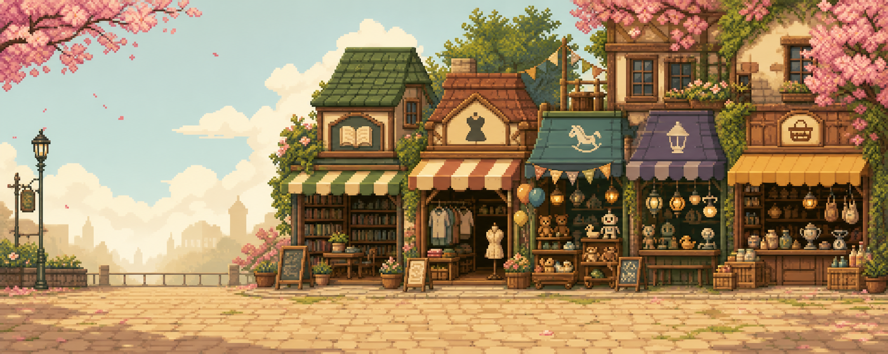
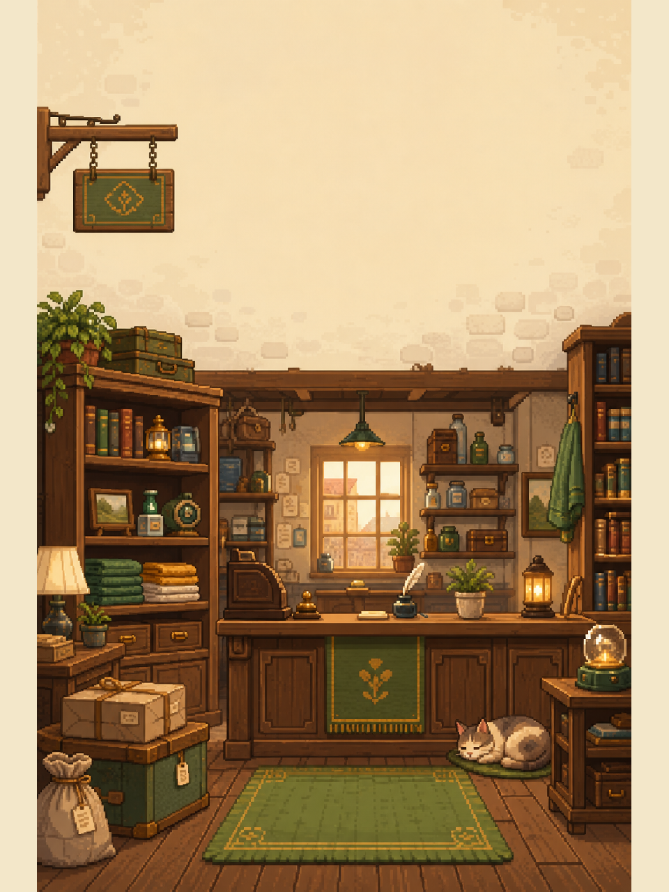
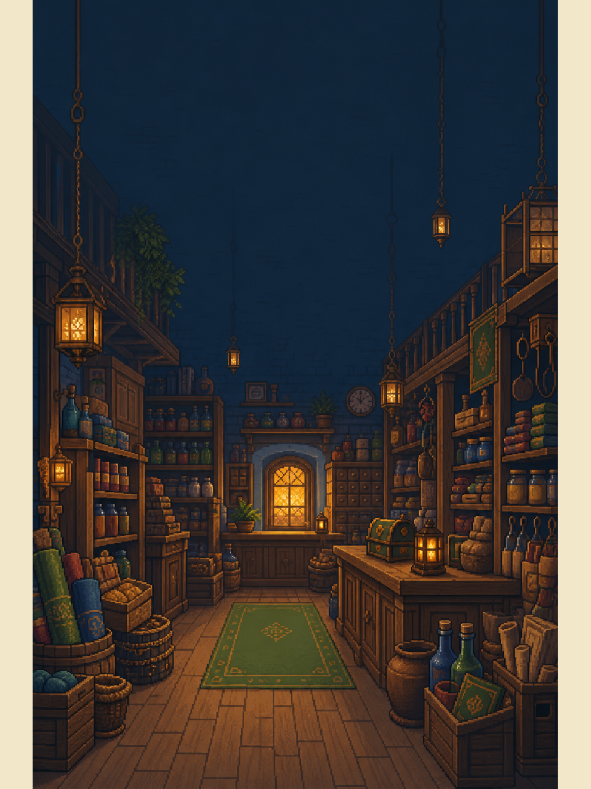
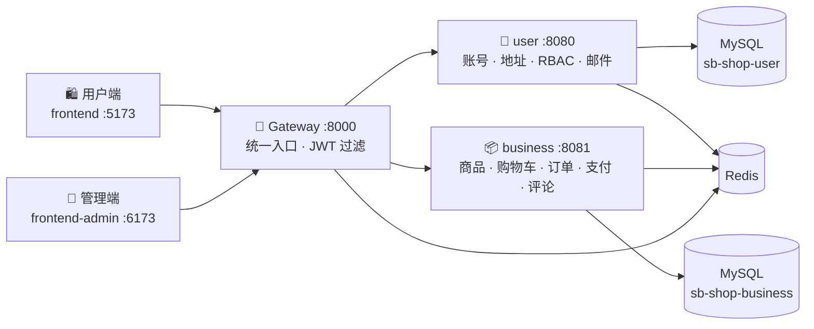
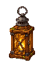
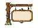
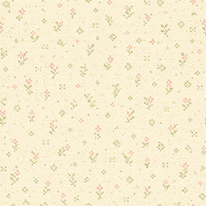
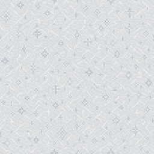

<div align="center">


<h1>
  
  Pixel Emporium · 像素百货
  
</h1>

<p><b>一座藏在像素小镇里的全栈商城</b><br/>Spring Boot 微服务 + Vue 3 双前端的像素风电商实训项目</p>

<p>
  
  
  
  
  
  
  <br/>
  
  
  
  
</p>

<p>
  <a href="#-功能概览">功能概览</a> ·
  <a href="#-四季主题">四季主题</a> ·
  <a href="#-架构与端口">架构</a> ·
  <a href="#-快速开始">快速开始</a> ·
  <a href="#-像素素材包">素材包</a> ·
  <a href="#-参与贡献">参与贡献</a>
</p>

</div>

<p align="center"></p>

##  项目简介

Pixel Emporium 是一个**像素风全栈商城实训项目**。界面保留"像素百货"的中文品牌与像素化视觉主题——从首页招牌、分类图标、光标到空状态插画都是手工风格的像素素材；后端采用 Spring Boot 微服务，前端采用 Vue 3（用户端 + 管理端）。

> [!NOTE]
> 本项目适合本地学习、演示和课程实训，**不面向真实生产交易**。

##  功能概览

<table>
<tr>
<td width="50%" valign="top">

#### 🛍️ 用户端（商城）

-  邮箱验证码注册、登录、JWT 鉴权
-  地址簿与个人资料管理
-  商品、分类树、SKU / 规格、折扣价
-  搜索建议、条件筛选、销量 / 评分排序、相关推荐
-  商品评分与评论（提交、修改、删除）
-  收藏夹与浏览历史
-  购物车、库存、订单创建 / 取消 / 确认
-  支付宝沙箱支付，及仅用于实训的模拟支付

</td>
<td width="50%" valign="top">

#### 🧰 管理端（后台）

-  管理仪表盘
-  商品 / SKU、分类管理
-  订单管理与发货
-  评论审核、隐藏与恢复
-  用户与 RBAC 角色权限
-  操作日志审计
-  SMTP 邮件中心（加密保存配置）
-  HTML 邮件模板预览、投递记录与失败重试

</td>
</tr>
</table>

<p align="center">
  
  
  
  
  
  
  
  
  
  
  
  
  
  
  
  
  
  
  <br/><sub>内置 19 个像素风商品分类图标</sub>
</p>

##  四季主题

首页招牌随季节切换，配套墙纸与飘落粒子（花瓣、萤火虫、落叶、雪花）一起营造小镇氛围。

<table>
<tr>
  <td align="center"><br/> <b>春</b></td>
  <td align="center"><br/> <b>夏</b></td>
</tr>
<tr>
  <td align="center"><br/> <b>秋</b></td>
  <td align="center"><br/> <b>冬</b></td>
</tr>
</table>

登录 / 注册页还有昼夜两套店铺场景：

<p align="center">
  
  &nbsp;&nbsp;
  
</p>

<p align="center"></p>

##  架构与端口



| 组件 | 目录 | 默认端口 | 职责 |
| --- | --- | ---: | --- |
| 用户端 Storefront | `frontend` | 5173 | 顾客购物与账户界面 |
| 管理端 Admin UI | `frontend-admin` | 6173 | 后台管理界面（含 Vditor 编辑器） |
| 网关 Gateway | `gateway` | 8000 | 统一 API 入口与 JWT 过滤 |
| 用户服务 | `user` | 8080 | 账号、地址、RBAC、SMTP 与邮件投递 |
| 商城服务 | `business` | 8081 | 商品目录、购物车、订单、支付、评论与推荐 |

`common`、`common-orm` 和 `common-security` 提供共享模型、数据库和鉴权能力；`generator` 是可选的代码生成模块。用户端和管理端都通过 Gateway 访问后端。用户服务与商城服务启动时由 **Flyway** 自动执行各自的数据库迁移。

##  快速开始

### 1. 环境要求

| 依赖 | 版本 |
| --- | --- |
| JDK | 21 |
| Node.js | `^20.19.0 \|\| >=22.12.0`（附带 npm） |
| MySQL | 8.x |
| Redis | 7.x |

Maven 无需单独安装，仓库自带 Maven Wrapper（`mvnw` / `mvnw.cmd`）。

### 2. 初始化数据库

先启动 MySQL 和 Redis，创建两个数据库（表结构由 Flyway 自动迁移）：

```sql
CREATE DATABASE `sb-shop-user` CHARACTER SET utf8mb4 COLLATE utf8mb4_unicode_ci;
CREATE DATABASE `sb-shop-business` CHARACTER SET utf8mb4 COLLATE utf8mb4_unicode_ci;
```

### 3. 配置环境变量

仓库保留以下三份可跟踪的开发配置，所有敏感值都是空的环境变量占位符：

- `user/src/main/resources/application-dev.yml`
- `business/src/main/resources/application-dev.yml`
- `gateway/src/main/resources/application-dev.yml`

启动前在当前终端设置所需环境变量。`JWT_SECRET` 必须在三个后端服务之间保持一致；RSA 私钥只放在本机环境中。

**核心变量（必填）：**

| 变量 | 说明 |
| --- | --- |
| `USER_DB_PASSWORD` / `BUSINESS_DB_PASSWORD` | 两个数据库的密码 |
| `JWT_SECRET` | JWT 签名密钥，三个服务一致 |
| `RSA_PRIVATE_KEY` | 登录密码传输解密用的 RSA 私钥 |
| `MAIL_CONFIG_MASTER_KEY_BASE64` | 加密保存 SMTP 配置的主密钥 |
| `MAIL_INTERNAL_HMAC_SECRET` | 服务间邮件请求签名密钥，user 与 business 一致 |
| `MAIL_VERIFICATION_PEPPER` | 邮箱验证码哈希 pepper |

**可选能力变量：**

| 能力 | 变量 | 未启用时 |
| --- | --- | --- |
| 支付宝沙箱 | `ALIPAY_ENABLED`, `ALIPAY_APP_ID`, `ALIPAY_SELLER_ID`, `ALIPAY_PRIVATE_KEY`, `ALIPAY_PUBLIC_KEY`, `ALIPAY_NOTIFY_URL`, `ALIPAY_RETURN_URL` | 设置 `PAYMENT_MOCK_ENABLED=true` 使用训练用模拟支付 |
| 对象存储 OSS | `OSS_ENABLED`, `OSS_ENDPOINT`, `OSS_ACCESS_KEY`, `OSS_SECRET_KEY`, `OSS_BUCKET` | 无法使用远程对象存储上传 |
| 商品像素风格化 | `PIXEL_STYLE_ENABLED`, `PIXEL_STYLE_API_BASE_URL`, `PIXEL_STYLE_API_KEY`, `PIXEL_STYLE_API_MODEL` | 无法调用图像模型把商品图转为像素风 |

前端通过各自的 `.env.local` 提供 API 地址和 RSA 公钥，可从示例复制：

```bash
cp frontend/.env.local.example frontend/.env.local
cp frontend-admin/.env.local.example frontend-admin/.env.local
```

> [!TIP]
> SMTP 密码不写入配置文件：启动后在管理端 **"邮件设置"** 页面配置并加密保存。未配置 SMTP 时商城仍可浏览商品，但邮箱验证码和订单邮件会被拒绝。

> [!WARNING]
> 不要提交真实密码、私钥、Token 或第三方密钥。`.env`、`.env.local`、`application-local.yml` 等已被 `.gitignore` 排除。

### 4. 启动开发环境

在项目根目录分别打开终端（Windows 使用 `.\mvnw.cmd`，macOS / Linux 使用 `./mvnw`）：

```bash
# 后端
./mvnw -pl user spring-boot:run
./mvnw -pl business spring-boot:run
./mvnw -pl gateway spring-boot:run

# 用户端
npm ci --prefix frontend
npm run dev --prefix frontend

# 管理端
npm ci --prefix frontend-admin
npm run dev --prefix frontend-admin
```

| 入口 | 地址 |
| --- | --- |
|  用户端 | http://localhost:5173 |
|  管理端 | http://localhost:6173 |
|  Gateway API | http://localhost:8000 |

管理员账号需要先按项目初始化数据，或自行注册后在数据库中授予相应角色。

### 5. 测试与构建

```bash
# 测试
./mvnw test
npm test --prefix frontend
npm test --prefix frontend-admin

# 生产构建
./mvnw package
npm run build --prefix frontend
npm run build --prefix frontend-admin
```

构建结果位于各前端的 `dist/` 和各 Maven 模块的 `target/`，均已被 `.gitignore` 排除。依赖安装请使用提交的 `package-lock.json`，推荐 `npm ci` 以获得可复现安装。

<p align="center"></p>

##  像素素材包

用户端和管理端共用一套像素 UI 素材，位于 `frontend/src/assets/pixel/` 与 `frontend-admin/src/assets/pixel/`。每张图都提供 `@1x` 和 `@2x` 两种尺寸，边框类素材采用九宫格（9-slice）切图。

| 目录 | 内容 | 预览 |
| --- | --- | --- |
| `icons/` | 48 个功能图标 |       |
| `categories/` | 19 个商品分类图标 |     |
| `common/` | 装饰物、星级评分、季节点缀、边框装饰 |       |
| `cursors/` | 像素鼠标指针 |     |
| `interactive/` | 灯笼开关与飘落粒子 |     |
| `auth/` | 登录页场景、店铺、猫咪、营业招牌 |    |
| `backgrounds/` | 四季招牌、天际线、墙纸、纸 / 木纹理 |     |
| `borders/` | 卡片、对话框、输入框、招牌九宫格 |   |
| `empty-states/` · `illustrations/` | 空状态与结果 / 错误页插画 | 见下方 |
| `transition/` | 页面转场遮罩 | 幕布、溶解、横扫 |

<table>
<tr>
  <td align="center"><br/><sub>空购物车</sub></td>
  <td align="center"><br/><sub>空收藏</sub></td>
  <td align="center"><br/><sub>空订单</sub></td>
  <td align="center"><br/><sub>无搜索结果</sub></td>
</tr>
<tr>
  <td align="center"><br/><sub>操作成功</sub></td>
  <td align="center"><br/><sub>操作失败</sub></td>
  <td align="center"><br/><sub>404</sub></td>
  <td align="center"><br/><sub>网络错误</sub></td>
</tr>
</table>

**像素字体**：内置 [Silkscreen](https://github.com/google/fonts/tree/main/ofl/silkscreen)（英文）与 [Fusion Pixel Font](https://github.com/TakWolf/fusion-pixel-font) 12px 中文子集，均遵循 SIL Open Font License 1.1，详见 [`frontend/src/assets/fonts/LICENSES.md`](frontend/src/assets/fonts/LICENSES.md)。

##  目录结构

```text
pixel-emporium/
├─ frontend/              # Vue 用户端
├─ frontend-admin/        # Vue 管理端（含 Vditor）
├─ gateway/               # Spring Cloud Gateway
├─ user/                  # 用户、权限、邮件服务
├─ business/              # 商品、订单、支付、评论服务
├─ common/                # 公共响应与基础组件
├─ common-orm/            # MyBatis-Plus 与数据库公共配置
├─ common-security/       # JWT 与请求鉴权
├─ generator/             # 可选代码生成器
├─ .github/               # CI 工作流、Issue / PR 模板
├─ .mvn/                  # Maven Wrapper 配置
├─ mvnw, mvnw.cmd         # Maven Wrapper 启动脚本
└─ pom.xml                # Maven 聚合根项目
```

##  实训边界

本仓库只保证本地实训场景下的可构建性，不提供线上部署、真实支付商户配置、生产级监控、SLA 或托管演示地址。支付宝、SMTP、OSS 和图像模型均为可选外部能力；请使用沙箱账号和临时凭据，并在实验结束后撤销相关密钥。

##  参与贡献

欢迎提交 Issue 和 Pull Request！开始之前请阅读 [贡献指南](CONTRIBUTING.md)；发现安全问题请按 [安全策略](SECURITY.md) 私下报告。

##  许可证

项目代码基于 [MIT License](LICENSE) 开源。内置字体文件遵循各自上游许可证（SIL OFL 1.1），见 [字体许可说明](frontend/src/assets/fonts/LICENSES.md)。

<div align="center">
  <br/>
  
  <sub>欢迎光临像素百货 · 用一个个像素搭起来的小店</sub>
</div>
